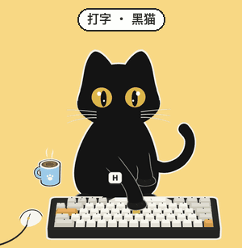
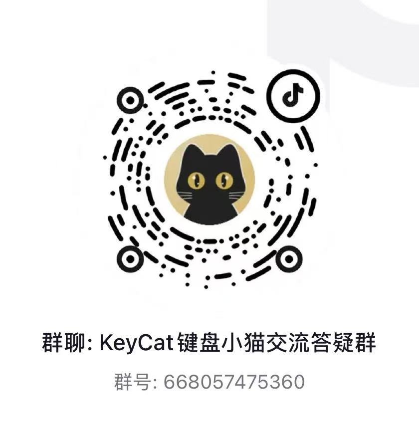
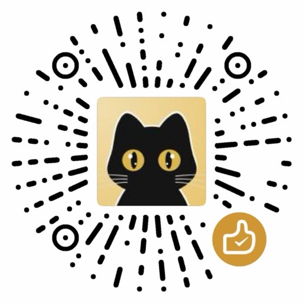

# KeyCat

一只住在你桌面上的猫。它趴在一把小键盘前，你打字，它也伸爪子跟着按；你晃鼠标，它扭头盯着看。摸摸头会眯眼呼噜，太久没人理就睡着，被烦到了会用尾巴捶桌子。

macOS、Windows、Linux 都能用，免费。除了检查更新，它不联网，也不记录你打了什么。



想先看看？[下载页](https://ellobodk.github.io/KeyCat/)上就有一只，可以直接用键盘鼠标逗它，页面也会按你的系统给出安装包。

## 安装

**macOS 13 及以上**：打开「终端」，粘贴这行回车，会装进「应用程序」并打开。

```sh
curl -L -o /tmp/KeyCat-macOS.zip https://github.com/ElloboDK/KeyCat/releases/latest/download/KeyCat-macOS.zip \
  && unzip -qo /tmp/KeyCat-macOS.zip -d /Applications && open /Applications/KeyCat.app
```

第一次打开时，去「系统设置 → 隐私与安全性 → 输入监控」里允许 KeyCat，再重新打开它。用浏览器下载的话，解压后拖进「应用程序」；提示「已损坏」时在终端执行 `xattr -dr com.apple.quarantine /Applications/KeyCat.app`。

**Windows 10 / 11**：下载 [`KeyCat-Windows-Setup.exe`](https://github.com/ElloboDK/KeyCat/releases/latest/download/KeyCat-Windows-Setup.exe) 运行，SmartScreen 拦下来时点「更多信息 → 仍要运行」。安装时选「仅为我安装」不需要管理员权限，公司电脑也能装；选「为所有用户安装」会装进 `C:\Program Files`，安装和更新时弹一次 UAC。

**Linux（64 位，X11）**：Ubuntu、Debian 在终端执行下面这行，装好后在应用列表里打开 KeyCat。

```sh
curl -L -o /tmp/KeyCat-Linux.deb https://github.com/ElloboDK/KeyCat/releases/latest/download/KeyCat-Linux.deb \
  && sudo apt install -y /tmp/KeyCat-Linux.deb
```

其他发行版下载 [`KeyCat-Linux.AppImage`](https://github.com/ElloboDK/KeyCat/releases/latest/download/KeyCat-Linux.AppImage)，`chmod +x` 后直接运行，放在自己有写权限的目录里才能自动更新。

装好之后不用再管：KeyCat 会在后台下载新版，点菜单里的「重启并更新」就换上。

## 和它相处

猫住在 mac 的菜单栏、Windows 和 Linux 的托盘里。**右键猫**或点图标打开菜单，**按住猫的身体**可以把它拖到别处。外观、桌面、习性这些都在菜单的「养猫设置…」里，改了马上生效。KeyCat 开着时再打开一次它，也会弹出设置。开机自启在设置的「系统」页。

- **陪你打字和用鼠标**：你按哪个键，它就按哪个键。它爪子下的小鼠标跟着你的鼠标走，按键和滚轮也会亮。
- **摸摸它**：鼠标按在猫头上是摸头，摸久了会呼噜、踩奶（声音默认关着）。双击猫头是对它慢眨眼，它可能会眨回来。
- **自己找事做**：闲着时会试探着把桌上的杯子推下去，被你撞见就僵住。没人理就睡着，睡久了趴到键盘上。
- **认得快捷键**：连按退格会冒汗，保存时点头，复制时把东西举过头顶，粘贴时放下。
- **照顾你**：连续工作 50 分钟左右，它会趴上键盘不让你打字，离开一会儿或摸摸它就下来。深夜会催你睡觉。想专心时可以在菜单里开番茄钟，时长在设置的「提醒」页里调。
- **有自己的日子**：节日和你们认识的纪念日会戴帽子或围巾，几天没见会生闷气。

## 打扮它

- **外观**：11 种毛色、眼睛颜色、项圈、腮红等。「捏一只」可以自己定毛色、花纹和体型，也能从照片里取色。
- **桌面**：键盘颜色、杯子、猫的大小和透明度。有四款成套的可爱桌面（猫爪、草莓牛奶、海盐小鱼、抹茶团子），鼠标和杯子跟着换；「定制」可以自己配色。桌上的鼠标按猫的视角亮键，打开「鼠标按猫的视角移动」后移动方向也跟猫一致。
- **声音**：在「桌面」页。呼噜声和音量，「键盘音效」可以选青轴、红轴、打字机，也有软软的肉垫「噗」、泡泡「啵」和音乐盒「叮」。
- **习性**：多久睡着，选性格（高冷、粘人、暴躁、胆小）或逐项调它的反应，每组都能让它当场演示一下。调错了可以撤销，单项也能一键恢复默认。
- **双猫**：在「外观」页再养一只，两只会互相拍，也可以分工，一只陪你打字，一只管鼠标。

「今日小结…」记着今天按了多少键、摸了它几次、它睡了多久和你们的关系等级，「养猫设置」的「外观」页里「拍一张动图」录一段 3 秒的 GIF，都存在「图片/KeyCat」。直播或录屏时打开「鼠标穿透」，点在猫身上的鼠标会落到下面的窗口，这时要从菜单栏或托盘图标打开菜单，或者再打开一次 KeyCat 回到设置。

## 常见问题

**mac 上猫对打字没反应？** 多半是还没给「输入监控」权限，菜单栏图标会显示 `🐈‍⬛⚠️`。按菜单里的提示去系统设置允许，再重新打开 KeyCat。

**Windows 上玩游戏时猫不动了？** 很多游戏以管理员身份运行，普通权限的 KeyCat 收不到发给它们的按键。在设置的「系统」页打开「以管理员身份运行」；装在 Program Files 里并开着开机自启时，之后不再每次弹 UAC。这时录屏软件要用整屏采集才抓得到猫。独占全屏的游戏会盖住猫，请改成无边框窗口模式。

**Linux 上猫对打字没反应？** 你可能在用 Wayland 会话，它不让程序收到发给别的窗口的按键。退出登录，在登录界面点右下角的齿轮，选名字里带 Xorg 或 X11 的会话（Ubuntu 是「Ubuntu on Xorg」）。

**Linux 上找不到托盘图标？** GNOME 要装 AppIndicator 扩展（Ubuntu 自带）才显示托盘。没有托盘时右键猫一样能打开菜单。

**它会偷看我打的字吗？** 不会。它只知道哪个键按下、什么时候抬起，用来让爪子落在对应的位置，只存次数和时长。

## 交流群

用法、bug、新点子都可以来群里聊：打开抖音搜索页扫一扫，或者搜群号 668057475360。也可以在 [Issues](https://github.com/ElloboDK/KeyCat/issues) 里反馈。



## 投喂罐罐

KeyCat 是一个人下班后慢慢做出来的。它陪你打字的时候要是逗你笑了一下，可以请它吃个罐罐：微信扫一扫，多少都行。菜单里的「投喂罐罐…」也能打开这张码，打开时桌上的猫会踩一会儿奶。



不投也没关系，它照样每天陪着你打字。

## 开源与许可

v1.2.0 起 KeyCat 不再公开源码：越来越多人拿开源代码加点小改动就收费倒卖，我一个人管不过来。KeyCat 还是免费的，我会继续更新维护，已经装好的照常自动更新。官方版本只在本仓库的 [Releases](https://github.com/ElloboDK/KeyCat/releases) 和[下载页](https://ellobodk.github.io/KeyCat/)发布，不再接受 PR。

- 免费使用，但不能收费转卖，也不能修改后发布。完整条款见 [LICENSE](LICENSE)。
- 「KeyCat」这个名字和图标从来不在授权范围内，基于旧版代码发布的修改版也不能用它们，别让人以为是官方版本。

Copyright (C) 2026 ElloboDK。形象和交互参考了一款付费桌面宠物应用，不包含对方的任何素材。安装包里用到的开源组件（three.js、Tauri、Electron 等）按各自的许可证使用，许可声明随安装包附带。
